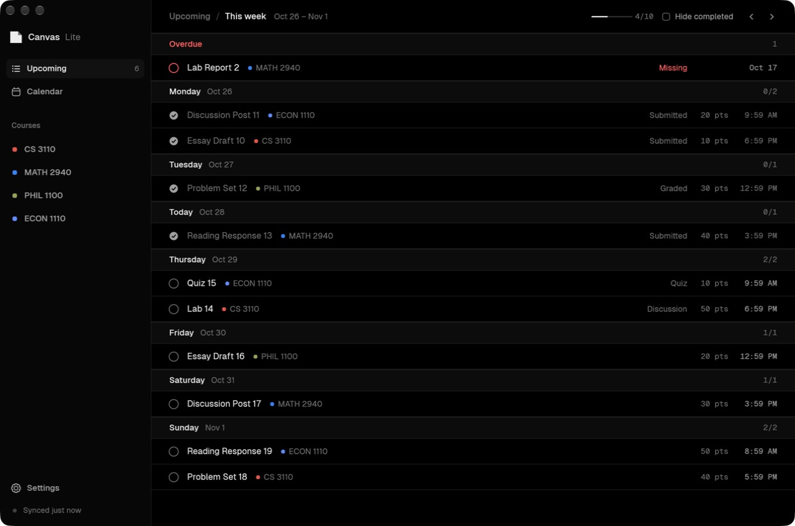

# Canvas Lite

A fast, minimal desktop client for [Canvas LMS](https://www.instructure.com/canvas). It shows what's due this week, your exams, and a short page for each class, and leaves out the rest of Canvas.



It's a native Rust app for macOS. Last-seen data is cached on disk, so the window has content the instant it opens; fresh data loads in the background.

## Features

- **Upcoming:** this week's assignments, quizzes and discussions, grouped by day. Missing work from earlier weeks appears in an Overdue group at the top, and exams in the next five weeks are listed first. Tick an item off and the change syncs back to Canvas's planner.
- **Calendar:** a week view with a column per day, or a month grid. Click a day in the month to open its week.
- **Exams:** found automatically. The app looks for Canvas assignments named like exams, and reads dates written in the syllabus, for example "Exam 2: Tuesday, 11/3…", "midterms on Mon, Sep 21, and Mon, Oct 26", or "Week of Oct 26, during your lab", which it matches to your lab's day and time.
- **Course pages** with six tabs:
  - **Overview:** grade, exams, what's next, missing work, recent announcements.
  - **Grades:** each assignment group with its weight and your percentage.
  - **Assignments:** upcoming, undated and past.
  - **Announcements:** as plain text.
  - **Modules:** collapsible.
  - **Syllabus:** including syllabi kept in **Simple Syllabus**, which the app fetches and caches. A search box filters the syllabus to matching lines.
- **Readable course names:** registrar names like `26 FALL COMP 120 (250,500-511): PROGRAM DESIGN & CONCEPTS` become `COMP 120` and "Program Design & Concepts · Fall 2026".
- **Menu bar:** an icon showing how many items are due today or left this week, or the next item's name, or nothing. Clicking it lists the next two weeks. Closing the window keeps the app running in the menu bar.
- **Privacy:** settings to hide course grades and assignment scores. Each course's grade can be revealed for one session.
- **Design:** black and white themes, Geist Sans and Mono, 1px hairlines instead of cards. Colour is used only for each course's Canvas colour and for overdue work.

## Install

You'll need macOS 11 or later and Rust 1.88 or later.

```sh
git clone https://github.com/EthanMcKanna/canvas-lite.git
cd canvas-lite
./dev/bundle.sh --install   # builds, signs and copies "Canvas Lite.app" to /Applications
```

`bundle.sh` signs the app with the first "Developer ID Application" certificate in your keychain, or ad-hoc if there isn't one. Either way, a locally built app runs without Gatekeeper warnings. Without `--install`, the app is left in `target/`.

## Signing in

On first launch, enter your school's Canvas address and click **Continue with browser**. A login window opens on your school's normal sign-in page, and SSO and Duo work as usual. When you reach the Canvas dashboard, the window closes and the app uses that session from then on.

If your school allows personal access tokens, you can paste one instead. You can also set the `CANVAS_URL` and `CANVAS_TOKEN` environment variables.

Your login is saved on your Mac only, in `~/Library/Application Support/canvas-lite/config.json` with mode `0600`. Cached data is in `~/Library/Caches/canvas-lite/`. The app talks to nothing except your school's Canvas and the syllabus tools it links to.

## Keyboard

| Key | Action |
| --- | --- |
| `U` / `C` | Upcoming / Calendar |
| `W` / `M` | Calendar week / month |
| `←` / `→` | Previous / next week or month |
| `T` | Today |
| `1`–`9` | Open a course |
| `R` | Refresh |

## How it works

- **UI:** [egui](https://github.com/emilk/egui), rendered with OpenGL. It runs at the display's full refresh rate and stays smooth during live resize, which the Metal/wgpu backend didn't on ProMotion displays.
- **Data:** the [Canvas REST API](https://canvas.instructure.com/doc/api/), called with `reqwest`. Requests run in parallel, and every course page and the weeks either side are prefetched in the background.
- **Sign-in and syllabi:** the app starts copies of itself as small WebKit helpers (`--login`, `--extract`), using `wry`/`tao`. The login helper captures the Canvas session. The extract helper opens LTI tools like Simple Syllabus in a hidden window and reads the rendered text.
- **Menu bar:** `tray-icon`, with a native menu.

| File | What's in it |
| --- | --- |
| `src/api.rs` | Canvas client and data models |
| `src/app.rs` | App state, networking and actions |
| `src/app/ui.rs` | Screens |
| `src/app/calendar.rs` | Week and month calendar |
| `src/theme.rs` | Design tokens and drawn widgets |
| `src/exams.rs` | Exam detection in titles and syllabus text |
| `src/names.rs` | Course-name and title clean-up |
| `src/web.rs` | WebKit helpers for sign-in and syllabus extraction |
| `src/tray.rs` | Menu bar item |
| `src/store.rs` | Config, preferences and cache |

## Development

```sh
cargo test                     # parsers: exams, names, HTML
python3 dev/mock_canvas.py     # a fake Canvas on :8765, including a fake SSO page
CANVAS_URL=http://localhost:8765 CANVAS_TOKEN=x cargo run --release
swift dev/icon.swift assets/icon/icon-1024.png   # redraws the app icon
```

## License

MIT for the code (see [LICENSE](LICENSE)). Geist and Geist Mono are © Vercel and licensed under the SIL Open Font License (see [assets/fonts/OFL.txt](assets/fonts/OFL.txt)).

Canvas Lite is an independent project, not affiliated with or endorsed by Instructure. Canvas is a trademark of Instructure, Inc.
